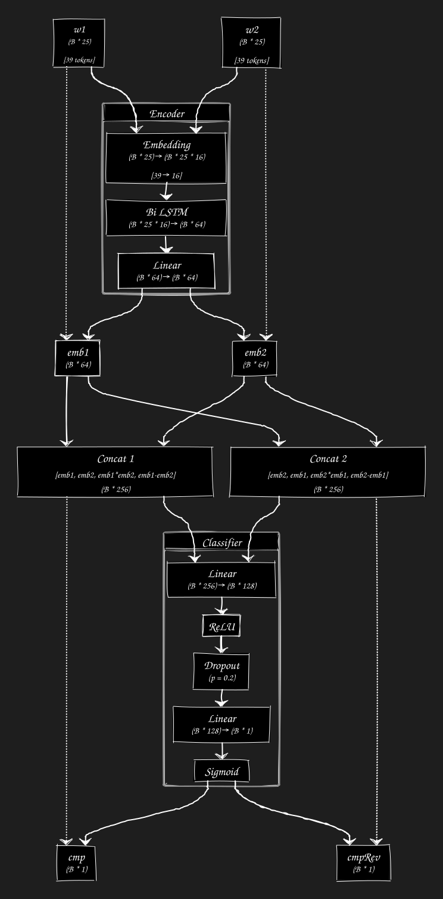

# Prettier Plugin Sort Props – How It Works

> [!NOTE]
> For instructions on how to use it, see the [plugin’s README](prettier-plugin-sort-props/README.md).

## Introduction

`prettier-plugin-sort-props` is a Prettier plugin that sorts JSX attributes (props) in your code. It ensures a consistent, configurable order by working within Prettier’s formatting process and using AI where needed. This document explains the plugin’s algorithms, data flow, and main steps.

## Overall Data Flow

The plugin follows these steps:

1. **Parse JSX** and extract all prop names.
2. **Group props** by splitting at any spread attributes.
3. **Normalize** each prop name.
4. **Sort each group**:

   1. Build a directed acyclic graph (DAG) from the custom prop order.
   2. Add any missing edges using the built-in order.
   3. **Sort with AI**:

      1. Topologically sort the DAG.
      2. If props tie, use AI to compare them.
   4. **Stable sort with AI**:

      1. Create a matrix of pairwise AI comparison scores.
      2. Use the Bradley-Terry model to rank props.
      3. Add edges from this ranking to the DAG.
      4. Topologically sort the DAG.
   5. **Sort without AI**:

      1. Add edges based on the props’ original order.
      2. Topologically sort the DAG.

### Parsing JSX

The plugin uses Prettier’s TypeScript parser to read JSX. This means it works only with React props. After parsing, we walk through the resulting object one field at a time. When we find a `JSXElement` node, we pull out its props and sort them. To do this, we simply reorder the element’s `attributes` array by prop name.

### Grouping Props

Before sorting, we split props into groups at each `JSXSpreadAttribute`. This is because spread props can overwrite those before or after them, so we keep each group separate. For example, given:

```tsx
<Component
  prop1="value1"
  prop2="value2"
  {...spreadedProps1}
  prop3="value3"
  prop4="value4"
  {...spreadedProps2}
  prop5="value5"
  prop6="value6"
/>
```

we sort `['prop1', 'prop2']`, `['prop3', 'prop4']`, and `['prop5', 'prop6']` separately. This preserves their place relative to the spread props.

> [!IMPORTANT]
> Note that changing prop order may affect execution. See <https://github.com/prettier/prettier/issues/323#issuecomment-273751697>.

### Normalizing Props

Different codebases use different naming styles, such as `camelCase`, `kebab-case`, or `snake_case`. To treat these consistently, we convert each prop name to a lowercase, space-separated string. For example, `onClick` becomes `"on click"` and `data-testId` becomes `"data test id"`.

### Sorting Props

We sort each group of normalized props using three levels of rules: user-defined order, built-in order, and AI. First, we build a directed acyclic graph (DAG) of prop names based on any user-defined list of props.

##### Wildcards

Both user-defined and built-in prop lists can include a simple wildcard at the end of a string. A wildcard is any sequence of characters followed by `*`. This matches all props that start with the given prefix. For example:

* The wildcard `on *` (with a space before `*`) matches props whose normalized names start with `"on "`. So it matches `onClick` (normalized to `on click`) and `on-start` (normalized to `on start`), and `on_submit` (normalized to `on submit`).
* The wildcard `on*` (no space) matches props that start with `"on"` directly. That includes `onClick` (normalized to `on click`), `once` (normalized to `once`), and `onionRoute` (normalized to `onion route`).

When we see a wildcard pattern, we collect all prop names in our DAG whose normalized strings begin with the prefix (the wildcard string without `*`). If there is no wildcard in a pattern, we check whether that exact normalized name is in the DAG.

##### Building the DAG

To build the DAG, we start with all prop names in one graph as nodes. Then we follow these steps using an ordered list `O` (from user settings or built-in) and the set of props in our group:

1. **Find the first matching node**
   Scan `O` from left to right. For each entry in `O`:

   * If the entry is a wildcard, gather every node in the DAG whose name starts with the wildcard’s prefix.
   * Otherwise, if the entry is an exact prop name and it is in the DAG, take that node.
     Stop once you find at least one node. Call this set of nodes `currentSet`.

2. **Add edges from the next entries**
   Continue scanning each next entry in `O`:

   * For each entry, collect its matching nodes (using the same wildcard or exact-name rule). Call this set `nextSet`.
   * If `nextSet` is empty, skip it and keep scanning.
   * Otherwise, for every node `u` in `currentSet` and every node `v` in `nextSet`, check if there is already a path from `v` to `u` in the DAG. If no path exists, add a directed edge `u -> v` (so `u` comes before `v`). This step ensures we do not create cycles.
   * After adding valid edges, update `currentSet` to include any nodes from `currentSet` that had no new outgoing edge plus all nodes in `nextSet`. In other words, if a node in `currentSet` never gained an edge to any node in `nextSet` (because all potential edges would create a cycle), it remains as part of `currentSet` for the next round.

3. **Transitive closure through topological order**
   Because we only add edges between immediate "next" nodes and skip pairs that would create a cycle, the final graph stays acyclic. Any longer ordering (for example, `O[i] → O[i+2]`) is implied by transitive edges once the graph is complete.

This process gives us a DAG where edges reflect the user's preferred order (respecting wildcards), without creating cycles. If any entry in `O` does not match a node, we simply ignore it. Later, when sorting, we will use this DAG to enforce the custom order first.

After adding edges from the user-defined list, we add edges from the built-in order in the same way. We use the built-in list as our ordered prop list, scan it left to right, match wildcards or exact names, and add edges without creating cycles.

##### Built-In Order

The built-in order lives in [`order.ts`](./prettier-plugin-sort-props/src/order.ts). It covers common HTML attributes, SVG attributes, React props, CSS properties, and Tailwind-like shorthands (for example, `mt`, `pl`). These are sorted by opinion, based on several online sources listed in [sources](./training/sources.txt). We include these props because they are standard attributes, and many UI libraries let you pass CSS properties as props.

##### Topological Sort and Tie Cases

Once all possible edges are in the DAG, we run a topological sort to produce an order. However, two issues arise:

1. **Untracked Edge Cases**
   The graph-building step can miss some rare edge cases. If certain relations are not captured, the topological sort may not reflect the intended order.

2. **Ties in Topological Sort**
   During topological sort, if two nodes have the same incoming edges, their order is not fixed. For example, with edges

   ```
   a -> b
   a -> c
   ```

   both `b` and `c` become valid next nodes after `a`. In those tie situations, we use AI as a tiebreaker.

#### Simple Sorting with AI

In the simplest AI-backed approach, whenever the topological sort faces a tie, we compare the two props with the AI. The AI returns which prop should come first, and we pick that. Internally, we use a priority queue (heap) to handle these comparisons quickly.

#### Stable Sorting with AI

Because the AI model is small and not perfectly trained, its comparisons are not always transitive. For example, it might say `a < b` and `b < a` at the same time, creating a conflict. To fix this, we:

1. **Collect Pairwise Scores**
   For every pair of props `(x, y)`, we ask the AI for a score between 0 and 1 indicating how strongly it prefers `x` before `y`. A score above 0.5 means `x < y` (that is, `x` should come first).

2. **Weight Comparisons**
   If `score(x < y) = 0.8` and `score(y < x) = 0.7`, we choose `x` before `y` because 0.8 > 0.7. But we do this for every pair, building a full matrix of scores.

3. **Apply the [Bradley–Terry Model](https://en.wikipedia.org/wiki/Bradley%E2%80%93Terry_model)**
   We feed the score matrix into the Bradley–Terry model, which outputs a global ranking of all props. This ranking is a total order that best matches the pairwise scores.

4. **Add Edges from AI Ranking**
   We treat that global ranking as another ordered list. We add edges between consecutive props in this ranking—skipping any that would create a cycle—in the same way we added user-defined or built-in edges.

5. **Final Topological Sort**
   With those extra edges in place, we run one more topological sort. Because we added the AI ranking, the result is a stable order that honors as many AI preferences as possible.

#### Sorting without AI

If the user opts out of AI, we simply topologically sort the DAG built from user-defined and built-in edges. However, ties can still arise in that sort. To make the result stable (so tied props keep their original relative order), we:

1. **Add Original-Order Edges**
   Scan the group’s original prop list from left to right. For each pair of props `(pi, pj)` where `i < j`, add an edge `pi -> pj` if it does not form a cycle. This ensures earlier props stay before later ones when no other rule applies.

2. **Run Topological Sort**
   The final sort will now respect user-defined rules, built-in rules, and, when needed, the original order.

## The AI

### Architecture



The AI model is a simple LSTM comparator. It uses a Siamese encoder: two identical LSTMs that each read one normalized identifier at the character level. We limit identifiers to 25 characters, padding shorter ones with zeros. Our character set has 39 symbols (letters a-z, digits 0-9, space, `$` for unknown, and `0` for padding).

Each encoder outputs a 64-dimensional embedding. We take the two embeddings, their dot product, and their difference, and feed those (256 numbers total) into a small linear classifier to get a score between 0 and 1.

To compare "A before B" versus "B before A," we swap the two embeddings and run the same classifier again. We subtract the reverse score from the forward score to get a signed value. Positive means "A < B," negative means "B < A."

### Other Considerations

I tested other designs-CNNs, multi-head attention, and transformers. I also tried a bilinear layer for richer interactions. Some of those gave slightly better accuracy, but added size and complexity. At the time, ONNX did not support bilinear layers, so I stuck with the LSTM.

### Dataset

My data comes from real `.tsx` and `.jsx` files in popular projects. I used Tree-sitter to parse each file and extract the props for every component. For each component, I made a line of text with its prop names in original order, joined by commas, and normalized as above.

Because different projects use different prop orders, I first applied the built-in order to each line. This partially sorts each list but keeps as many original relationships as possible (minimizing inversions). For details, see [this Reddit post](https://www.reddit.com/r/algorithms/comments/1ix38ym/algorithm_to_sort_an_array_under_constraints). The final dataset isn’t in this repo but can be rebuilt from the sources listed in the [sources](./training/sources.txt) file. The model sees only relative prop order, so there shuld not be any copyright issues.

### Training

Training happened mainly in Google Colab. All code is in [Sorter_lstm.ipynb](./training/Sorter_lstm.ipynb). The model reached about 88.9% accuracy, though I stopped early. Note that I added the reverse-comparison pass only for inference; the original training used a single forward comparison.

After training, I exported and simplified the model to ONNX. Now it’s ready to use!
